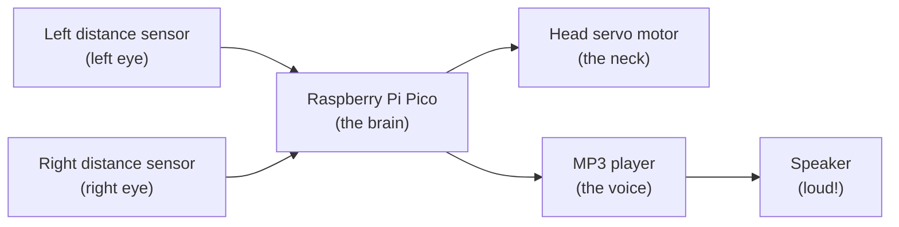
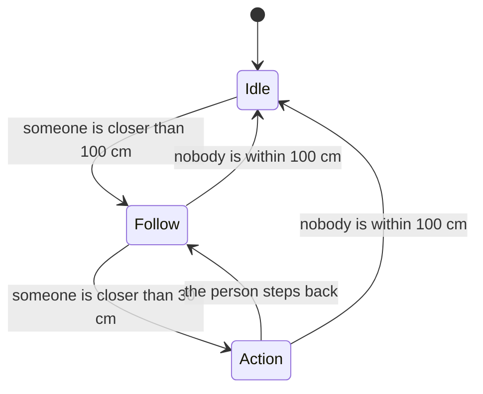

# Scary Monster Circuit — Schematics

This document explains how the Halloween prop is built, in a way that a
12-year-old can follow. Read it from top to bottom: every picture comes with a
simple explanation of what it means and why it is there.

## 1. What are we building?

We are building a monster head that sits still, then looks around, and when
somebody comes close it turns towards them and plays a scary song.

Think of it like a little robot with three jobs:

1. **Watch** with two "eyes" that measure how far away things are.
2. **Think** with a small computer (the Raspberry Pi Pico).
3. **React** by turning its head with a motor and playing music.

## 2. The big picture

This picture shows the main parts and how they talk to each other. Follow the
arrows: information goes in from the left, the Pico thinks, and the results
come out on the right.

How to read it:

- The two sensors are like eyes. They tell the brain how far a person is.
- The Pico is the brain. It decides what to do.
- The servo is a motor that can point the head left, centre, or right.
- The MP3 player is the voice. It plays the scary song through the speaker.

## 3. The parts you need

| Part | What it is | What it does |
| --- | --- | --- |
| Raspberry Pi Pico | A tiny computer board | Runs our program and controls everything |
| 2 × distance sensors | Small boards that measure distance | Act as the left and right "eyes" |
| 1 × servo motor | A motor that turns to an exact angle | Turns the monster head |
| 1 × UART MP3 player | A small music player board | Plays the scary song from an SD card |
| 1 × speaker | Makes sound | Lets everybody hear the song |
| 1 × 5V power supply | Batteries or a 5V adapter | Gives electricity to all the parts |
| Jumper wires | Coloured wires | Connect everything together |

## 4. The electrical schematic (the wiring)

This is the most important picture. It shows the real breadboard with every
part and every wire, exactly as you plug it in. The colours tell you what each
wire does, and the labels tell you the pin on the Pico.

The same information as a table, so you can check every wire one by one:

| From | Pico pin | To | Why |
| --- | --- | --- | --- |
| Left sensor TRIG | GP2 | Left sensor | Sends a "ping!" |
| Left sensor ECHO | GP3 | Left sensor | Listens for the echo |
| Right sensor TRIG | GP4 | Right sensor | Sends a "ping!" |
| Right sensor ECHO | GP5 | Right sensor | Listens for the echo |
| Servo signal | GP16 | Servo | Tells the head where to look |
| MP3 player RX | GP0 (TX) | MP3 player | Sends commands to the player |
| MP3 player TX | GP1 (RX) | MP3 player | Optional replies from the player |
| Power + | 5V | Sensors, servo, MP3 | Gives electricity |
| Power − | GND | Sensors, servo, MP3 | Completes the circuit |

**Very important:** all the parts must share the same **GND** (the minus wire).
This is called a "common ground". Without it, nothing works because the
electricity has no way back.

## 5. How the brain decides: the state machine

The brain is always in one of three "moods", called states. This picture shows
how it moves from one mood to another. Read the arrows as "when this happens,
change mood".

What each mood means:

- **Idle** — the monster is waiting. The head looks straight ahead.
- **Follow** — someone is within 100 cm, so the head turns towards them.
- **Action** — someone is within 30 cm, so the song starts. Very scary!

## 6. Step-by-step build

Follow these steps in order. Take your time and check each wire twice.

1. **Put the Pico on the table.** This is the brain.
2. **Connect the power.** Wire the 5V and GND of the power supply to the Pico.
   Do not turn the power on yet.
3. **Add the left sensor.** Connect TRIG to GP2 and ECHO to GP3, plus 5V and GND.
4. **Add the right sensor.** Connect TRIG to GP4 and ECHO to GP5, plus 5V and GND.
5. **Add the MP3 player.** Connect the Pico's GP0 (TX) to the player's RX, and
   GP1 (RX) to the player's TX. Add 5V and GND. Plug the speaker into the player.
6. **Add the servo.** Connect the servo signal wire to GP16, and its power wires
   to 5V and GND.
7. **Check the common ground.** Make sure every part's minus wire meets at the
   same point.
8. **Power on** and wave your hand in front of the sensors. The head should
   follow you. Come closer than 30 cm to hear the song.

## 7. Safety tips

- Ask a grown-up before using a power supply or a soldering iron.
- Never connect the plus and minus wires directly to each other.
- If something gets hot or smells strange, turn the power off immediately.
- Keep the moving head away from fingers when the motor is on.
